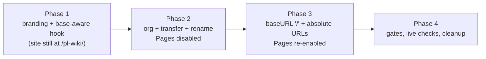

# Rename plan: `pl-wiki` → LambdaFolio (org site at `lambdafolio.github.io`)

> Status: **executed** (2026-11-07). The site is live at
> <https://lambdafolio.github.io/> from
> [`lambdafolio/lambdafolio.github.io`](https://github.com/lambdafolio/lambdafolio.github.io);
> this document is retained as the record of what was done and why, including
> the outcome notes at [Execution record](#execution-record).
>
> Two decisions drove everything below:
>
> 1. **The public URL must be `https://lambdafolio.github.io`** — that is a
>    *user/org site*, which GitHub only serves from a repository literally named
>    `<owner>.github.io`, at the domain **root**. Therefore `app.baseURL` must
>    go from `/pl-wiki/` to `/` (today's project-site prefix disappears from
>    every URL).
> 2. **Old URLs may break.** No redirect shim, no `mlhaufe.github.io/pl-wiki/`
>    compatibility page, no `jekyll-redirect-from`-style artifacts.

## Verified current state

| Fact | Value |
| --- | --- |
| Repo | `mlhaufe/pl-wiki` (public, default branch `master`, 2.2 MB) |
| Pages URL | `https://mlhaufe.github.io/pl-wiki/` (live, HTTP 200) |
| Pages type | **project site** → `baseURL: '/pl-wiki/'`, `site.url: 'https://mlhaufe.github.io'` |
| Deploy | `.github/workflows/deploy.yml` → `npm run generate` → `upload-pages-artifact` → `deploy-pages` |
| Org `lambdafolio` | **available** (`api.github.com/users/lambdafolio` and `/orgs/lambdafolio` both 404) |
| `lambdafolio.github.io` | 404 (free) |
| `mlhaufe/mlhaufe.github.io` | exists but is **empty** (size 0) — irrelevant to this plan |
| Free org plan | sufficient (public repo, GitHub Pages allowed) |
| Branding strings in tree | 45 non-ignored occurrences across 25 files (inventory below) |

## Target layout

| Item | Current | Target |
| --- | --- | --- |
| Product name | Programming Language Wiki / PL Wiki | **LambdaFolio** |
| Org | *(none)* | `lambdafolio` |
| Repo | `mlhaufe/pl-wiki` | `lambdafolio/lambdafolio.github.io` |
| Site URL | `https://mlhaufe.github.io/pl-wiki/` | `https://lambdafolio.github.io/` |
| `app.baseURL` | `/pl-wiki/` | `/` (can be dropped entirely) |
| `site.url` | `https://mlhaufe.github.io` | `https://lambdafolio.github.io` |
| `package.json` `name` | `pl-wiki` | `lambdafolio` |
| Page URLs | `/pl-wiki/languages/smalltalk/` | `/languages/smalltalk/` |
| Edit links | `github.com/mlhaufe/pl-wiki/edit/master/…` | `github.com/lambdafolio/lambdafolio.github.io/edit/master/…` |

Why the repo name is `lambdafolio.github.io` and not `lambdafolio`: a repo
named `lambdafolio` under the org would serve `lambdafolio.github.io/lambdafolio/`
— a project site with a prefix again, i.e. the thing we are removing. Naming
the app repo `<owner>.github.io` is the standard single-repo org-site pattern
(the account already has one precedent: `thenewobjective/thenewobjective.github.io`).

### Rejected alternative

Keep `lambdafolio/lambdafolio` as the source repo and add a second, thin
`lambdafolio/lambdafolio.github.io` repo that publishes the build. That needs a
cross-repo push (fine-grained PAT + `peaceiris/actions-gh-pages` or equivalent),
a long-lived secret, and two repos to keep in sync. Not worth it for a
single-site org; revisit only if a second project ever needs the org domain.

## Phases

Each phase is independently committable and reversible. Phases 1–2 change no
URLs; phase 3 changes all of them at once, on purpose.

### Phase 1 — Branding rename inside the repo (URLs unchanged)

Safe to land while the site still lives at `mlhaufe.github.io/pl-wiki/`.
Nothing in this phase depends on GitHub-side changes.

#### 1.1 `package.json` + lockfile

- `package.json:2` — `"name": "pl-wiki"` → `"name": "lambdafolio"`.
- `package-lock.json:2` and `:7` — same two `"name"` fields (or run
  `npm install --package-lock-only` to regenerate; do not `npm ci` blindly,
  it rewrites the whole lock tree if dependency ranges drifted).

#### 1.2 `nuxt.config.ts`

- `:30` module meta name `pl-wiki-prerender-routes` → `lambdafolio-prerender-routes`.
- `:59` fallback warning prefix `[pl-wiki]` → `[lambdafolio]`.
- `:67` **make the prerender hook base-aware** instead of hard-coding the
  project prefix:

  ```ts
  // inside setup(), before the nitro:config hook:
  const base = (nuxt.options.app.baseURL || '/').replace(/\/$/, '')
  // …
  for (const p of paths) nitroConfig.prerender.routes.push(`${base}${p}`)
  ```

  This is the one behavioural edit worth doing now: after phase 3 `app.baseURL`
  becomes `'/'` and `base` is `''`, so the same code keeps working, and the
  hook no longer encodes a site-shape assumption.
- `:87–89` comment + `app.baseURL` (phase 3, not now — see 3.1).
- `:96–97` `site.url` (phase 3).
- `:132–140` Studio `repository: { owner: 'mlhaufe', repo: 'pl-wiki' }`
  (phase 3, after the move).

#### 1.3 Human-facing strings

- `.devcontainer/devcontainer.json:4` `"name": "Programming Language Wiki"` → `"LambdaFolio"`.
- `README.md:1` `# Programming Language Wiki` → `# LambdaFolio`, plus a
  one-line tagline (see [Copy](#copy-to-use)).
- `server/plugins/feed.ts:14,16` feed `title` and `copyright`.
- `public/images/icons/site.webmanifest` — `name`/`short_name` → `LambdaFolio`,
  and **make icon paths relative** (`"android-chrome-192x192.png"` instead of
  `"/pl-wiki/images/icons/…"`), because the manifest lives in that same
  directory and relative paths survive any future base change.
- `.github/skills/{language,paradigm,feature}-entry/SKILL.md` — `:3` description
  `(pl-wiki)` → `(lambdafolio)` and `:7` H1 `(pl-wiki)` → `(lambdafolio)`.
- `.markdownlint-cli2.jsonc:2` comment `— pl-wiki (language entries)` → `— lambdafolio (language entries)`.
- `app/assets/css/main.css:5` — keep the historical provenance but name the
  new owner: `Ported theme tokens from the legacy Jekyll theme (_sass/pl-wiki.scss).`
- `app/utils/with-base.ts:3` — the comment hard-codes `/pl-wiki/`; reword to
  "the configured app base URL (empty for a root/org site)".
- `TODO.md:1` `# PL List` → `# Backlog` (optional, but it is the only remaining
  "PL" branding).

#### 1.4 Docs (do **not** rewrite history)

- `docs/knowledgebase-plan.md:1` — `# Knowledgebase Plan: PL Wiki as a
  normalized language database` → `… : LambdaFolio as a normalized language
  database`.
- `docs/migration-nuxt-plan.md` — this is the **completed Jekyll→Nuxt
  migration record**; its `pl-wiki` / `mlhaufe.github.io` references (lines
  17, 22, 39, 45, 191, 195) describe the pre-rename world. Add a banner under
  the title:

  ```markdown
  > Historical record (pre-rename). Site names, URLs, and paths below describe
  > the `pl-wiki` project site as it was during the Jekyll→Nuxt migration. The
  > project is now LambdaFolio at <https://lambdafolio.github.io>.
  ```

  Do not touch the rest — rewriting a migration log makes it unreadable.

### Phase 2 — GitHub org + repository move

Do these on github.com in the shared browser session (the local `gh` CLI has an
**invalid token for `mlhaufe`** — `gh auth status` reports the active account's
token is invalid, and only `mlhaufe-bevfed` is authenticated; re-auth or use the
UI).

1. **Create the org** — <https://github.com/account/organizations/new> →
   Free plan → name `lambdafolio` → owner is `mlhaufe`.
2. **Pause deployments before moving** — Actions → *Deploy to GitHub Pages* →
   ⋯ → *Disable workflow*. (Pages settings do **not** follow a transfer; the
   site will be down until phase 2.5 anyway. Pausing first avoids a race where
   a push during the move deploys from a half-renamed repo.)
3. **Transfer** — `mlhaufe/pl-wiki` → Settings → General → Danger zone →
   *Transfer ownership* → `lambdafolio` → confirm by typing the repo name.
   History, branches, issues, and Actions workflow files come along; **Pages
   config, environments, and secrets do not**.
4. **Rename** — in the new repo: Settings → General → Repository name →
   `lambdafolio.github.io` → *Rename*. GitHub will warn that the name looks
   like a Pages site; that is the intent.
5. **Re-enable Pages** — Settings → Pages → Source: **GitHub Actions**
   (the `github-pages` environment is recreated on first deploy).
6. **Update the local remote**:

   ```sh
   git remote set-url origin https://github.com/lambdafolio/lambdafolio.github.io.git
   git remote -v   # verify
   ```

   The old `github.com/mlhaufe/pl-wiki` path keeps redirecting for git/UI
   traffic, but the old **Pages** URL stops serving — accepted.

### Phase 3 — Flip the site to the domain root

One commit; pushes trigger the (re-enabled) Pages workflow.

#### 3.1 `nuxt.config.ts`

- `:87–89` — drop the prefix entirely (root is the default):

  ```ts
  // Organization site: https://lambdafolio.github.io/
  app: {
    head: { htmlAttrs: { lang: 'en-US' } }
  },
  ```

  (Leaving `baseURL: '/'` is equivalent; removing the key makes the intent
  clear. `useBaseUrl()` already normalizes `/` → `''`, so `withBase()` keeps
  returning `/logos/…`, unchanged.)

- `:96–97` — `site.url: 'https://lambdafolio.github.io'` (site-config composes
  canonical/sitemap URLs as `url + baseURL`; with baseURL `/` that is now the
  bare origin).
- `:132–140` — Studio repository
  `{ provider: 'github', owner: 'lambdafolio', repo: 'lambdafolio.github.io' }`.

#### 3.2 Absolute URLs written by hand

- `public/robots.txt:3` — `Sitemap: https://lambdafolio.github.io/sitemap.xml`.
- `server/plugins/feed.ts:13,17` (and the `:14,16` titles from 1.3) —
  `id`/`link` → `https://lambdafolio.github.io/`.

#### 3.3 Edit links (8 occurrences, 4 files)

Each collection page has the same pair (empty-state CTA + "Edit this entry"
rail):

- `app/pages/languages/[slug].vue:229,319`
- `app/pages/paradigms/[slug].vue:177,262`
- `app/pages/features/[slug].vue:176,301`
- `app/pages/families/[slug].vue:181,281`

All become `https://github.com/lambdafolio/lambdafolio.github.io/edit/master/content/<collection>/${route.params.slug}.md`.

Optional cleanup while touching them: the eight copies of that template string
are a good candidate for one shared helper (e.g. `app/utils/edit-url.ts`
exporting `editUrl(collection, slug)`) so the next rename is a one-line change.
Out of scope if you want the diff minimal.

#### 3.4 Dev container (paths are namespaced by the repo name)

- `.devcontainer/Dockerfile:10,25` — `WORKDIR /workspace/lambdafolio`.
- `.devcontainer/compose.yml:15,16` — bind mount and `node_modules` volume at
  `/workspace/lambdafolio/…`; `:20` comment; `:27` network `lambdafolio-dev`.
- `.devcontainer/devcontainer.json:7` — `"workspaceFolder": "/workspace/lambdafolio"`;
  `:10` comment (`baseURL: /pl-wiki/` → root site).

Because the `node_modules` volume path changes, the next container build
re-runs `npm ci` into a fresh volume (one slower first start; no native-module
mismatch, since the volume was already Linux-side).

#### 3.5 `README.md` — URLs and structure block

- `:7` deployed URL; `:25`, `:34` dev URLs
  (`http://127.0.0.1:3000/` — **no** `/pl-wiki/` suffix);
- `:256` project-structure line `nuxt.config.ts  modules, baseURL (/pl-wiki/), …`
  → `modules, site URL, feed config`.
- Deployment section: keep the "Pages source must be GitHub Actions" sentence,
  add that the repo is now `lambdafolio/lambdafolio.github.io`.

#### 3.6 `.github/workflows/deploy.yml:37`

Comment only: `Site URL is already set in nuxt.config.ts (https://lambdafolio.github.io)`.
No workflow logic changes — `upload-pages-artifact`/`deploy-pages` are
owner-agnostic.

### Phase 4 — Verify, then clean up

#### 4.1 Gates (all must pass before pushing phase 3)

```sh
npm run lint:frontmatter
npm run lint:body
npm run lint:markdown
npm run check:filters
npm run generate
```

#### 4.2 Root-site assertions (new; replace the old `/pl-wiki/` preview dance)

```sh
# 1. No stale prefix anywhere in the build (expect zero hits):
grep -rIl "/pl-wiki" .output/public | head
grep -rIl "mlhaufe"      .output/public | head

# 2. Assets and pages are root-relative:
grep -o 'src="/_nuxt/[^"]*"'      .output/public/index.html | head -3
grep -o 'href="/languages/'      .output/public/index.html | head -3

# 3. Generated metadata carries the new origin:
head -6 .output/public/feed.xml
cat   .output/public/robots.txt
grep -o 'https://lambdafolio.github.io[^<]*' .output/public/sitemap.xml | head -3

# 4. Content cross-links still resolve (ContentRenderer prefixes baseURL):
grep -o 'href="[^"]*languages/smalltalk[^"]*"' \
  .output/public/paradigms/object-oriented/index.html | sort -u
#   → href="/languages/smalltalk"   (previously /pl-wiki/languages/smalltalk)

# 5. Preview at the root (no directory shim needed any more):
npx serve .output/public    # open http://localhost:3000/
```

Point 5 is a real simplification: the repo memory note that the build must be
copied into a directory named `pl-wiki` before serving is **obsolete** after
phase 3 — delete that note when the plan is executed.

#### 4.3 Live checks after the first org deploy

- `https://lambdafolio.github.io/` returns 200 and assets load (no
  `_nuxt/…` 404s).
- Spot-check a deep page (`/languages/smalltalk/`), the compare page, and a
  prerendered index (`/paradigms/`).
- `sitemap.xml` lists `https://lambdafolio.github.io/…` (no `/pl-wiki/`).
- `feed.xml` `id`/`link` are the new origin; `robots.txt` sitemap line matches.
- One page's "Edit this entry" link opens the file in
  `lambdafolio/lambdafolio.github.io`.
- Studio (dev only): `npm run dev` → `/` (no base) → Studio button → repo
  picker resolves to the org repo.
- Optional: submit the new sitemap in Google/Bing/Bing Webmaster — old URLs
  intentionally 404.

#### 4.4 Local housekeeping

- Rename the working copy if desired: `~/projects/mlhaufe/pl-wiki` →
  `~/projects/lambdafolio/lambdafolio.github.io` (or keep the path; only
  `.devcontainer` mounts depend on the *container* path, not the host path).
- Update the repo memory note (`/memories/repo/pl-wiki.md`): new name, new
  base URL, and delete the `/pl-wiki/` preview workaround.
- Leave `mlhaufe/mlhaufe.github.io` alone — it is empty and unused. (It would
  only matter if a redirect shim were wanted, which it is not.)

## Sequencing (why this order)



Doing phase 3 first would deploy root-relative HTML to
`lambdafolio.github.io/pl-wiki/` (or to the old project site) and every
`_nuxt/` asset would 404. Disabling Pages in phase 2 means the unavoidable
"site is between homes" window produces a clean 404 rather than a broken page.

## Copy to use

| Slot | Proposed text |
| --- | --- |
| Product name | `LambdaFolio` |
| Tagline (README, feed, manifest) | `A programming-language atlas: normalized facts, influences, and paradigms.` |
| `package.json` name | `lambdafolio` |
| Repo | `lambdafolio/lambdafolio.github.io` |
| Feed `copyright` | `LambdaFolio contributors` |

Optional branding follow-up (separate change, not part of the rename):
`nuxt.config.ts` has no site-wide `titleTemplate` and the home page sets no
`useSeoMeta({ title })`, while every sub-page hard-codes its own title. Adding
`app.head.titleTemplate: '%s · LambdaFolio'` (plus a home title) would make the
new name visible in every tab and search result. Note this changes all page
titles at once — worth its own commit.

Also unrelated but adjacent: `public/images/icons/*` (favicons + `site.webmanifest`)
are not referenced from `app.head` at all, so the manifest edit in 1.3 keeps a
file that is currently dead weight. Either wire `<link rel="icon">` /
`<link rel="manifest">` during this work or leave the file as-is; do not let it
become a silently stale `/pl-wiki/`-prefixed artifact.

## Rollback

- **Phase 1** — pure string edits; `git revert` is clean.
- **Phase 2** — GitHub can transfer the repo back to `mlhaufe` and rename it
  `pl-wiki`; history is preserved either way, but the Pages environment and the
  deploy run that produced the org site must be re-established, and the old
  project URL only works again after a successful deploy to that name.
- **Phase 3** — revert the commit and re-deploy; the org repo would then serve
  root-relative HTML at the domain root while the site is a `<owner>.github.io`
  site, so **phase 3 cannot be rolled back independently while the repo keeps
  its new name** — the only valid states are (old name + `/pl-wiki/` base) or
  (new name + root base). Plan to land 3.1–3.6 as one commit and verify in the
  same session.

## Checklist

### Phase 1 checklist

- [x] `package.json` + `package-lock.json` name → `lambdafolio`
- [x] `nuxt.config.ts` module meta, warn prefix, base-aware prerender hook
- [x] devcontainer name, README title, feed titles/copyright, webmanifest
      (name + relative icon paths), 3 skill files, markdownlint comment,
      `main.css`, `with-base.ts` comments, `TODO.md`
- [x] `docs/knowledgebase-plan.md` title; historical banner in
      `docs/migration-nuxt-plan.md`
- [x] `npm run lint:frontmatter && npm run lint:body && npm run lint:markdown && npm run check:filters && npm run generate`
- [x] Commit + push (site keeps working at `mlhaufe.github.io/pl-wiki/`)

### Phase 2 checklist

- [x] Create free org `lambdafolio` (owner `mlhaufe`)
- [x] Disable the Pages workflow
- [x] Transfer `mlhaufe/pl-wiki` → `lambdafolio`
- [x] Rename → `lambdafolio/lambdafolio.github.io`
- [x] Pages source = **GitHub Actions**
- [x] `git remote set-url origin …`

### Phase 3 checklist

- [x] Drop `app.baseURL`; `site.url` → org origin; Studio repo → org repo
- [x] `public/robots.txt`, `server/plugins/feed.ts` absolute URLs
- [x] 8 edit links across 4 `[slug].vue` pages
- [x] devcontainer paths/network, README URLs + structure block, workflow comment
- [x] Single commit, push, watch the deploy

### Phase 4 checklist

- [x] All four gates green; root-site assertions (no `/pl-wiki`, no `mlhaufe`)
- [x] Live smoke test incl. sitemap/feed/robots and one edit link
- [ ] Rename working copy (optional, still `~/projects/mlhaufe/pl-wiki`)

## Execution record

Landed 2026-11-07 in three commits (`a20ef7c`, `d9f882a`, `c8a27a0`) plus a
branding follow-up.

### What deviated from the plan

**Pages settings survived the transfer.** The plan assumed they would not. The
site came across as `build_type: legacy`, source `master:/`, status `errored` —
so it had to be re-pointed at GitHub Actions
(`PUT /repos/{owner}/{repo}/pages -F build_type=workflow`) rather than
configured from scratch. Worth checking after any future transfer.

**An inherited ruleset already existed.** The transfer created a repository
ruleset named `default` covering `~DEFAULT_BRANCH` with `deletion` and
`non_fast_forward`. Branch protection is therefore now expressed as ruleset
`24754795` rather than classic protection; it carries a `pull_request` rule
with `required_approving_review_count: 0`. Raising that count would deadlock the
repository, because an organization with a single member cannot self-approve.
The ruleset has **no bypass actors**, so direct pushes to `master` are rejected
for the owner too — verified by attempting one.

**No API exists for two branding uploads.** Organization avatars and repository
social previews are web-UI only; both were uploaded through the browser. The org
display name, description, and website were set from the same settings page, and
the repository description/topics via `PATCH /repos/{owner}/{repo}` and
`PUT /repos/{owner}/{repo}/topics`.

**Pre-existing build bug fixed under this work.** The prerender-route module
read `.data/content/contents.sqlite` at `nitro:config` time. That database does
not exist yet on a fresh checkout, so on CI the module always took its
"fall back to crawling" path — and the homepage renders no link table, so the
crawl never reached most entries. **286 of 417 language pages were missing from
production** (confirmed against the old site: `/pl-wiki/languages/cadl/` → 404).
Discovery now reads the `source: '<dir>/*.md'` globs out of `content.config.ts`
and enumerates the content directory: 365 → 937 prerendered routes.

### Verified against the live site

| Check | Result |
| --- | --- |
| `/`, `/languages/smalltalk/`, `/paradigms/`, `/features/`, `/families/` | 200 |
| `/sitemap.xml`, `/feed.xml`, `/robots.txt` | 200, new origin throughout |
| Sitemap entries | 464, all `https://lambdafolio.github.io/…` |
| Formerly-missing pages (`cadl`, `cairo`, `carbon`, `apl`) | 200 |
| Route count vs. content | 417/417 languages, 29/29 paradigms, 6/6 features, 6/6 families |
| Stale `/pl-wiki` or `mlhaufe` references in the build | none |
| Organization avatar | new mark confirmed (byte comparison on the CDN URL) |
| Direct push to `master` | rejected: "Changes must be made through a pull request" |
| PR open → merge as the sole member | succeeds, `mergeStateStatus: CLEAN` |

## Branding assets

The mark lives in `public/images/brand/`:

| File | Purpose |
| --- | --- |
| `lambdafolio-icon-source.jpg` | original artwork (784×1168, kept for re-derivation) |
| `lambdafolio-icon.png` | 1024×1024 square master |
| `lambdafolio-icon-96.png` | nav logo (the master is 466 KB; not worth shipping per page) |

`public/images/icons/*` and `public/favicon.ico` are generated from the master
by cropping to the card-stack bounds and **padding onto a square canvas with the
artwork's own black** — never cropping, which would clip the third card. The
document head links each size in `nuxt.config.ts`; before this work the icons
were present but referenced by nothing, so browsers fell back to the Jekyll-era
`favicon.ico`.

The manifest does not advertise `purpose: maskable`: the artwork runs to the tile
edges, and an Android mask would crop the stack.

The organization avatar is a 512×512 export of the master; the repository social
preview is a 1280×640 composition (mark plus wordmark on black). Both are
uploads, not repository files.
